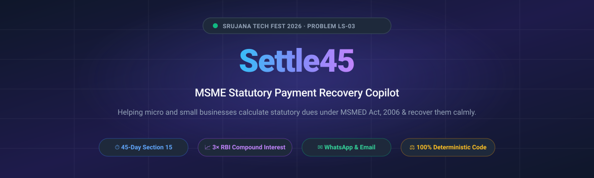
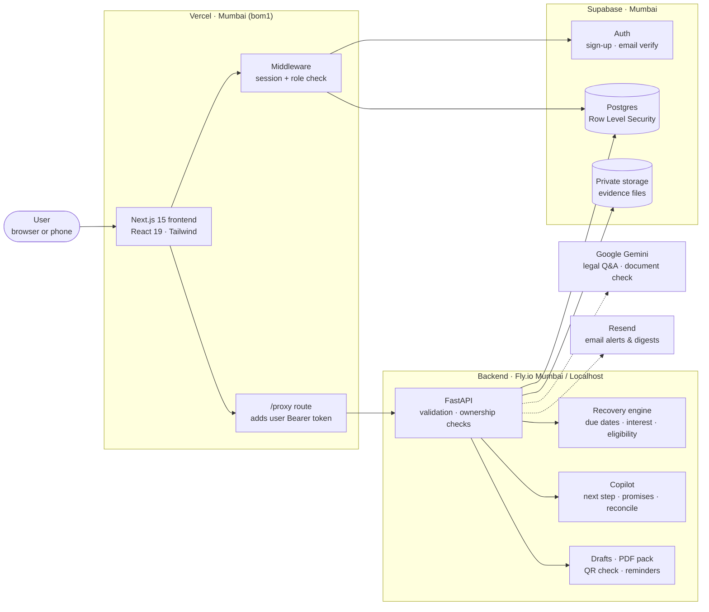
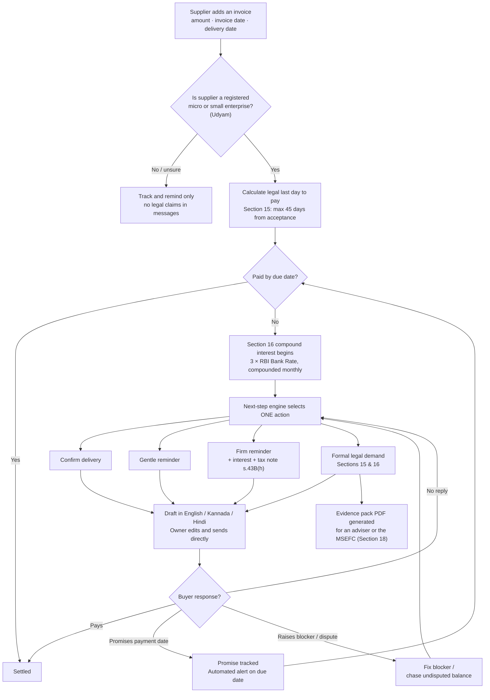
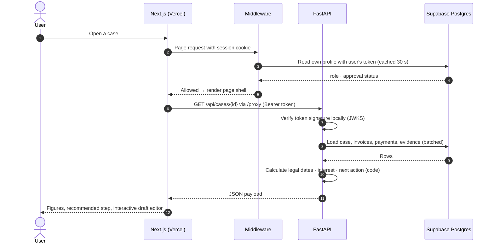
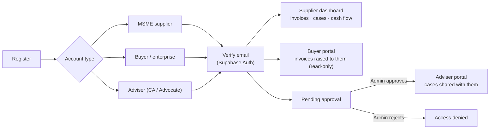
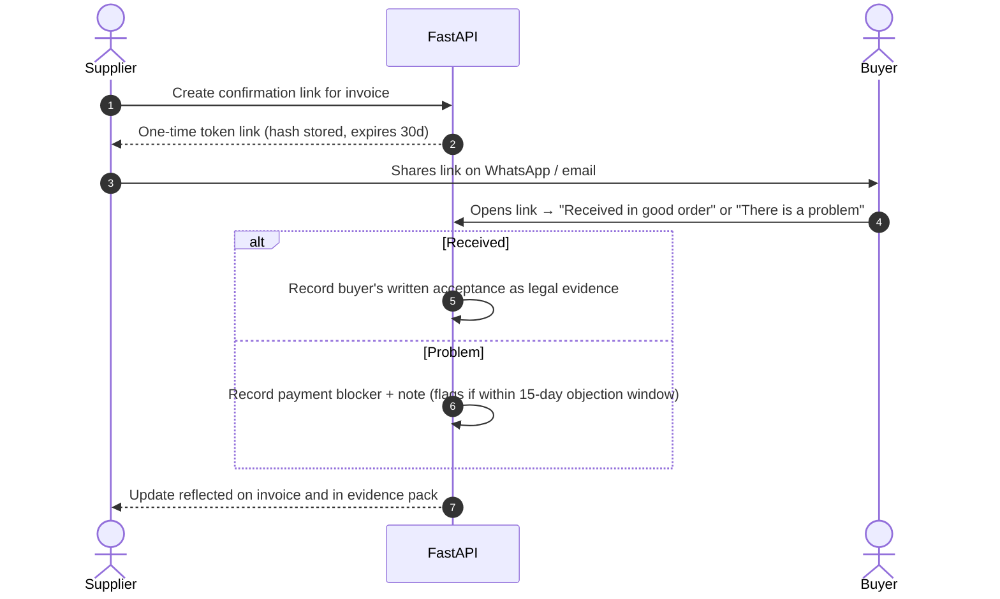
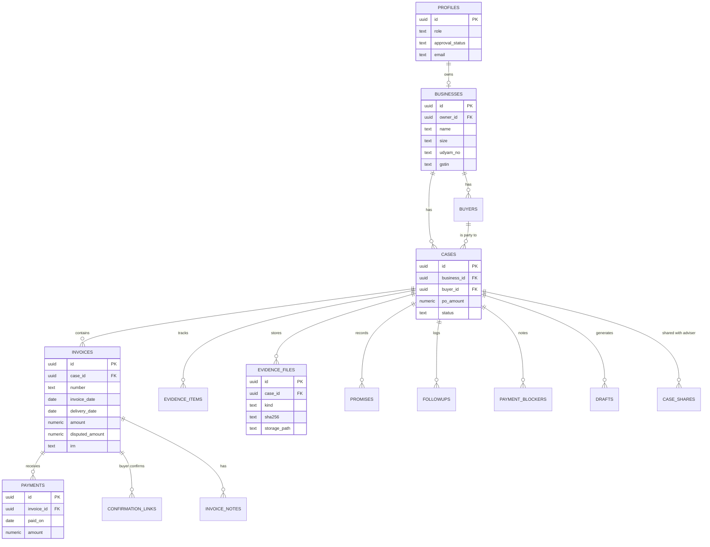
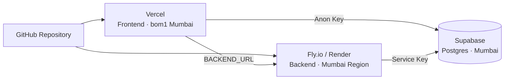

<p align="center">
  
</p>

<p align="center">
  
  
  
  
  
  
</p>

<p align="center">
  <b>Helping micro and small businesses understand what they are owed under the MSMED Act, 2006 —<br>and recover it, while keeping their customers.</b>
</p>

<p align="center">
  Built for <b>Srujana Tech Fest 2026</b> · Chanakya University · Legal Services theme · Problem <b>LS-03</b>
</p>

---

## Contents

- [The problem](#the-problem)
- [What Settle45 does](#what-settle45-does)
- [Architecture](#architecture)
- [How it works](#how-it-works)
  - [1. The recovery journey](#1-the-recovery-journey)
  - [2. Request lifecycle](#2-what-happens-on-one-request)
  - [3. Sign-in and roles](#3-sign-in-and-roles)
  - [4. Buyer confirmation link](#4-buyer-confirmation-no-account-needed)
- [The legal engine](#the-legal-engine)
- [Data model](#data-model)
- [Tech stack](#tech-stack)
- [Security](#security)
- [Project structure](#project-structure)
- [Getting started](#getting-started)
- [Configuration](#configuration)
- [Database migrations](#database-migrations)
- [Testing](#testing)
- [Deployment](#deployment)
- [Disclaimer](#disclaimer)

---

## The problem

India's **Micro, Small and Medium Enterprises Development (MSMED) Act, 2006** says a buyer must pay a registered micro or small supplier within **45 days of acceptance** (Section 15). If the buyer is late, the law adds compound interest at **three times the RBI Bank Rate**, with monthly rests (Section 16).

In practice, most small suppliers:
- **Don't know the exact legal due date** or how much statutory interest they are owed.
- **Fear losing the customer** if they push too hard or too early.
- **Have their evidence scattered** across WhatsApp chats, email threads, delivery challans, and paper invoices.
- **Cannot afford a lawyer** just to understand where they legally stand.

**Settle45** turns the Act into exact statutory figures, clear recommended actions, and ready-to-send messages — so the supplier can recover their dues calmly, professionally, and in the right order.

---

## What Settle45 does

| Feature | What it means for the supplier |
|:---|:---|
| **Invoice tracking** | Every invoice with its legal last day to pay, amount owed, payment history, and live status. |
| **Legal due date & interest** | Section 15 statutory deadline and Section 16 compound interest calculated by deterministic code — never guessed by AI. |
| **Next-step engine** | One clear action at a time: Confirm delivery &rarr; Gentle reminder &rarr; Firm reminder &rarr; Legal demand. |
| **Message drafts** | Ready-to-send notices in English, Kannada, and Hindi with figures filled in by code; open in WhatsApp or your email client. |
| **Buyer confirmation link** | One-time link the buyer clicks to verify delivery — no account needed; verified receipt becomes admissible evidence. |
| **Payment blockers** | Track why a buyer is holding payment (missing PO, GRN, GST mismatch, quality check) and draft the fix. |
| **Partial disputes** | Disputed amounts are held separately while undisputed amounts continue to be actively chased. |
| **Evidence vault** | Secure storage for POs, delivery challans, and communications with SHA-256 integrity fingerprints. |
| **Evidence pack (PDF)** | One-click export of case figures, interest schedules, payment trails, and evidence ready for an adviser or the MSEFC. |
| **E-invoice QR check** | Decodes signed GST e-invoice QR codes and compares fields directly with your invoice records. |
| **Daily reminders** | Timely alerts for invoices approaching due dates, promises due or broken — in-app and via Resend email digests. |
| **Cash flow forecast** | 8-week forward cash flow projection showing what is owed now, what is due soon, and who to follow up with first. |
| **Legal assistant** | Plain-language explanations of the MSMED Act powered by Google Gemini with voice input capability. |
| **Four distinct roles** | Dedicated workflows for MSME Suppliers, Buyers / Enterprises, Advisers (CA/Advocate), and Administrators. |

---

## Architecture



> **Three parts, one region.** The frontend, backend, and database are configured for low-latency delivery in Mumbai (`bom1` / `ap-south-1`). Secret keys (Supabase service key, Gemini key, Resend API key) reside only on the backend — never exposed to client browsers.

---

## How it works

### 1. The recovery journey



---

### 2. What happens on one request



---

### 3. Sign-in and roles



---

### 4. Buyer confirmation (no account needed)



---

## The legal engine

All statutory figures are computed by plain, tested Python code in `backend/recovery_engine/` — **AI never calculates interest or due dates**.

| Rule | Legal Source | How Settle45 applies it |
|:---|:---|:---|
| **Eligibility** | MSMED Act Section 2, Udyam registration | Verifies size (micro/small), activity (manufacturing/services), and registration dates before invoking statutory provisions. |
| **Day of acceptance** | Section 2(b) | Actual delivery date, unless a written objection is received within 15 days of delivery. |
| **Statutory due date** | Section 15 | Agreed payment date capped strictly at 45 days from acceptance; 15 days if no agreement exists. |
| **Penal interest** | Section 16 | **3 × RBI Bank Rate**, compounded monthly. Rate lookups use exact historical rates per period. |
| **Non-deductibility** | Section 23 | Informs the buyer that interest paid under Section 16 cannot be deducted for income tax purposes. |
| **Buyer's tax disallowance** | Income-tax Act Section 43B(h) / Finance Act 2025 s.37(2)(g) | Highlights that unpaid MSME invoices will be disallowed from the buyer's tax deductions at year-end. |
| **Reference to Council** | Section 18 (MSEFC) | One-click compilation of petition-ready evidence pack PDF for filing on Samadhaan. |
| **Partial objection** | Industry practice / Rule A9 | Holds only the disputed portion; payments allocate to undisputed principal first. |

---

## Data model



---

## Tech stack

| Layer | Technology | Why chosen |
|:---|:---|:---|
| **Frontend** | Next.js 15 (App Router), React 19, TypeScript | Server components, fast static generation, robust server-side authentication checks. |
| **Styling** | Tailwind CSS 4, Lucide React Icons | Responsive, mobile-friendly interface designed for shop-floor owners on phones. |
| **Charts** | Recharts | Interactive aging band and 8-week cash flow visualization with SSR hydration safety. |
| **Backend** | FastAPI, Pydantic v2, Python 3.12 | Exact decimal mathematics, strict validation, high-throughput asynchronous execution. |
| **Database** | Supabase Postgres with Row Level Security | Strict multi-tenant isolation: users can only read and mutate their own verified records. |
| **Authentication** | Supabase Auth, JWT (JWKS validation) | Secure email verification, password recovery, session rotation, local cryptographic validation. |
| **Document Storage** | Supabase Storage (private bucket) | Encrypted storage for evidence documents with SHA-256 fingerprinting. |
| **PDF Generation** | ReportLab | Programmatic vector PDF compilation of the comprehensive MSME Evidence Pack. |
| **QR Decoding** | jsQR (browser-side) & PyJWT | Instant camera/file decoding of signed B2B e-invoices with RSA signature verification. |
| **AI Layer** | Google Gemini 3.5 Flash | Fast multimodal document reading and grounded legal conversational assistant. |
| **Notifications** | Resend API | Automated daily email digests for approaching statutory deadlines and broken promises. |
| **Testing** | pytest, Vitest | 276 backend tests, 39 database RLS policies, and 41 frontend unit tests. |

---

## Security

- **Row Level Security (RLS)**: Enforced at the Postgres database level across all tables. Suppliers access only their business data; buyers only view invoices billed to them; advisers access only explicitly shared cases.
- **Zero Client-Side Secrets**: Service-role keys, Resend credentials, and Gemini API keys reside exclusively in the backend runtime.
- **Cryptographic Evidence Fingerprinting**: Files uploaded to the Evidence Vault are verified by actual byte headers and hashed with SHA-256 to guarantee document immutability.
- **One-Time Token Security**: Buyer confirmation links store only salted SHA-256 token hashes with automatic 30-day expiration.
- **Strict Input Validation**: Pydantic v2 validates all payloads (GSTIN checksum calculation, PAN structure, IRN format, positive monetary bounds).
- **Secure Cookie Strategy**: Session cookies utilize `HttpOnly`, `SameSite=Lax`, and `Secure` flags. Cross-site state modification through `/proxy` is blocked.
- **Human-in-the-Loop Principle**: The application **never** dispatches messages or legal notices to buyers autonomously. The business owner reviews and approves every communication.

---

## Project structure

```
msme-recovery-copilot/
├── frontend/                       # Next.js 15 web application
│   ├── app/                        # App Router: cashflow, cases, invoices, buyer, adviser, legal...
│   ├── components/                 # UI components: cases, charts, blockers, evidence, assistant
│   ├── lib/                        # API client, auth validation, formatting helpers
│   ├── middleware.ts               # Route protection, session caching & role routing
│   └── vercel.json                 # Mumbai (bom1) deployment configuration
├── backend/                        # FastAPI REST API & calculation engine
│   ├── app/                        # API routes, auth, drafts, files, reminders, cashflow, QR, store
│   ├── recovery_engine/            # Deterministic MSMED Act due dates, interest & settlement logic
│   ├── copilot/                    # Next-action decision trees, promise tracking, reconciliation
│   └── tests/                      # 276 pytest unit & integration tests
├── supabase/                       # Database migrations & schemas
│   ├── migrations/                 # 001 – 013 SQL migrations
│   ├── seed.sql                    # Demo data scenarios
│   └── tests/                      # 39 Row Level Security tests
├── docs/                           # Documentation assets and deployment guides
└── scripts/run_all_checks.sh       # Comprehensive one-step CI verification script
```

---

## Getting started

### Option A — Demo Mode (Quickest, no setup required)

Runs entirely with in-memory test data for a supplier, buyer, and adviser.

```bash
# 1. Start the Backend
cd backend
python -m venv .venv
source .venv/bin/activate       # Windows: .venv\Scripts\activate
pip install -r requirements.txt
STORE=memory uvicorn app.main:app --port 8000

# 2. Start the Frontend (in a new terminal)
cd frontend
npm install
npm run build && npm start     # Visit http://localhost:3000
```

---

### Option B — Production Mode with Supabase

1. **Create Supabase Project**: Create a new project in Mumbai (`ap-south-1`).
2. **Apply Database Migrations**: Run migrations `001` through `013` from `supabase/migrations/` in sequence in the Supabase SQL Editor.
3. **Configure Environment Variables**:
   - Copy `.env.example` to `backend/.env` and provide `SUPABASE_URL` and `SUPABASE_SERVICE_KEY`.
   - Copy `frontend/.env.example` to `frontend/.env.local` and provide `NEXT_PUBLIC_SUPABASE_URL` and `NEXT_PUBLIC_SUPABASE_ANON_KEY`.
4. **Start Application**:
   ```bash
   # Backend
   STORE=supabase uvicorn app.main:app --port 8000
   
   # Frontend
   npm run build && npm start
   ```

---

## Configuration

### Backend (`backend/.env`)

| Variable | Required | Purpose |
|:---|:---:|:---|
| `STORE` | Yes | `memory` (offline demo) or `supabase` (real database). |
| `SUPABASE_URL` | With Supabase | Your project REST endpoint (`https://xyz.supabase.co`). |
| `SUPABASE_SERVICE_KEY` | With Supabase | Service-role administrative key (server-side only). |
| `CORS_ORIGINS` | Yes | Allowed frontend origins (e.g., `http://localhost:3000`). |
| `GEMINI_API_KEY` | Optional | Enables Gemini AI legal Q&A and document reading. |
| `GEMINI_MODEL` | Optional | Default model (`gemini-3.5-flash`). |
| `RESEND_API_KEY` | Optional | Enables automated email reminders and digests. |
| `NOTIFICATION_EMAIL` | Optional | Default recipient for supplier reminder digests. |
| `EINVOICE_PUBLIC_KEY` | Optional | GST Portal RSA public key to verify QR signatures. |

### Frontend (`frontend/.env.local`)

| Variable | Required | Purpose |
|:---|:---:|:---|
| `NEXT_PUBLIC_SUPABASE_URL` | With Supabase | Public Supabase project URL. |
| `NEXT_PUBLIC_SUPABASE_ANON_KEY` | With Supabase | Public anonymous client key. |
| `NEXT_PUBLIC_SITE_URL` | Yes | Canonical site URL (`http://localhost:3000`). |
| `BACKEND_URL` | Yes | Upstream API address (used by `/proxy` route). |

---

## Database migrations

| # | Migration | What it provides |
|:---:|:---|:---|
| `001` | `init.sql` | Core entities: businesses, buyers, cases, invoices, payments, evidence. |
| `002` | `copilot.sql` | Copilot schema: payment promises, follow-ups, dispute annotations. |
| `003` | `auth_roles.sql` | User profiles, role definitions (supplier, buyer, adviser, admin), approval triggers. |
| `004` | `profile_notes_milestones.sql` | Extended business profiles, contract delivery milestones, invoice notes. |
| `005` | `buyer_links_case_shares.sql` | Buyer portal read access policies and adviser case sharing grants. |
| `006` | `security_hardening.sql` | Strict security hardening on profile updates and table access grants. |
| `007` | `payment_blockers.sql` | Tracking of operational payment blockers (PO, GRN, tax, quality). |
| `008` | `partial_disputes.sql` | Segregation of disputed vs undisputed invoice amounts. |
| `009` | `confirmation_links.sql` | Cryptographic one-time buyer delivery confirmation tokens. |
| `010` | `invoice_irn.sql` | GST e-invoice Invoice Reference Number (IRN) verification. |
| `011` | `reminder_dismissals.sql` | User preference persistence for dismissed reminder alerts. |
| `012` | `evidence_files.sql` | Private Supabase Storage bucket configuration and file tracking. |
| `013` | `draft_kinds_and_languages.sql` | Multilingual support for notices in English, Kannada, and Hindi. |

---

## Testing

Run all automated quality gates with one command:

```bash
bash scripts/run_all_checks.sh
```

| Suite | Test Count | What it validates |
|:---|:---:|:---|
| **Backend (pytest)** | **276** | Legal mathematics, interest calculations, copilot logic, drafts, reminders, QR checks, PDF generation. |
| **Database RLS** | **39** | Multi-tenant Row Level Security isolation across supplier, buyer, and adviser roles. |
| **Frontend (Vitest)** | **41** | Client-side API adapters, formatting helpers, and authentication rule evaluation. |
| **Type Check & Lint** | **0 errors** | Strict TypeScript 5 type verification and ESLint compliance across all components. |

---

## Deployment



| Component | Target Platform | Recommended Region |
|:---|:---|:---|
| **Frontend** | Vercel (Next.js) | Mumbai, India (`bom1`) |
| **Backend API** | Fly.io / Render | Mumbai (`bom`) / Singapore (`sin`) |
| **Database** | Supabase Postgres | Mumbai (`ap-south-1`) |

Detailed deployment instructions available in [`docs/DEPLOY.md`](file:///d:/hhhhh/ls03-recovery/ls03-recovery/docs/DEPLOY.md).

---

## Disclaimer

Settle45 provides statutory calculation estimates for educational and informational purposes under the MSMED Act, 2006. It does not constitute formal legal counsel. Output figures depend strictly upon invoice dates and documentation entered by the user. Kannada and Hindi notices are standardized templates. Consult a qualified professional (Advocate or Chartered Accountant) prior to instituting formal legal proceedings before the Micro and Small Enterprises Facilitation Council (MSEFC).

---

<p align="center">
  Made with care for India's small businesses · <b>Settle45</b> · Srujana Tech Fest 2026
</p>
